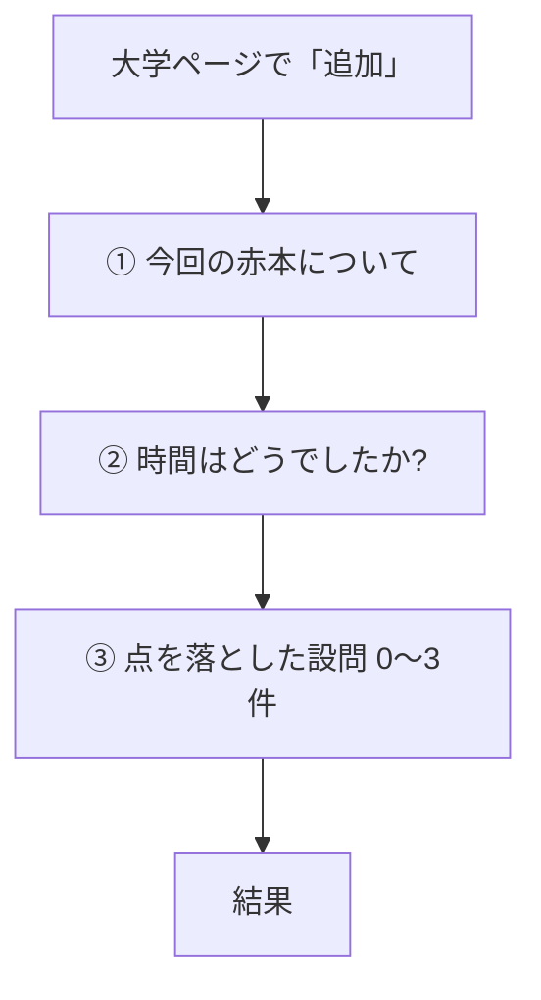

# 赤本記録の質問分岐(現状・編集用)

更新日: 2026-10-28
正本: `v3.html` のいまの動き。直したいところは表の右端「赤ペン」に書く。

---

## 1. 質問の画面(3つ。順番は固定)

大学のページで「追加」→ 直近のトリセツがあれば先に出す →

いまは出ない: 「何回目?」(自動) / 「まだの分野は?」 / 「習っていない」 / 「1日に使える時間」 / 「ひとこと」 / 「最初の一歩」

### ① 今回の赤本について

| 項目 | 必須 | 赤ペン |
|---|---|---|
| 解いた年度 | 必須。西暦4桁 | |
| 入試日程 | 任意 | |
| 全問題数 | 必須 | |
| 正答数 | 必須 | |

### ② 時間はどうでしたか?

| 選択肢 | あとに効くこと | 赤ペン |
|---|---|---|
| 余裕で、見直しまでできた | 時間不足 +0 | |
| ギリギリ終わった | 時間不足 +1 | |
| 時間が足りず、手がつかなかった大問があった | 時間不足 +3 | |

### ③ 点を落とした設問

最大3件。0件でも次へ。形式を選ぶと理由が入れ替わる。失点の大きさ: 大=3、中=2、小=1。

---

## 2. 形式 → 理由 → タグ

### 形式A: 用語・知識

| 理由 | つくタグ | 赤ペン |
|---|---|---|
| 覚えていなかった・うろ覚えだった | 知識不足 | |
| 似た用語と混同した | 知識不足 | |
| 用語は言えるが、仕組みがわかっていなかった | 理解不足 | |

### 形式B: 考察(実験・グラフ)

| 理由 | つくタグ | 赤ペン |
|---|---|---|
| 実験の条件の違いが整理できなかった | 考察 | |
| グラフの読み取りで手が止まった | 考察 | |
| 前提となる知識がなくて考えられなかった | 知識不足 | |

### 形式C: 論述

| 理由 | つくタグ | 赤ペン |
|---|---|---|
| 何を書けばいいかわからなかった | 理解不足 | |
| 書いたが、要素(キーワード)が足りなかった | 論述 | |
| 字数制限に収めようとして時間を浪費した | 論述 | |

### 形式D: 計算・遺伝

| 理由 | つくタグ | 赤ペン |
|---|---|---|
| 解き方がわからなかった | 理解不足 | |
| 立式はできたが、計算や処理でミスした | 計算・処理 | |

### 形式E: 選択肢(正誤)

| 理由 | つくタグ | 赤ペン |
|---|---|---|
| 根拠がわからず選べなかった | 知識不足 | |
| 2つで迷って外した | 知識不足 | |
| 問題文の条件を読み違えた(「誤っているもの」など) | ケアレス | |

同点のとき: 理解不足 → 知識不足 → 考察 → 論述 → 計算 → ケアレス → 時間不足。点が全部0なら「目だった課題なし」。

---

## 3. 結果のあと(ここで1本に絞る)

タグが2つ以上なら、生徒が1つ選ぶ。余力の提案は出さない。選んだタグで、次の追加質問とアクションが決まる。

| 選んだタグ | 追加の選択 | トリセツ | 赤ペン |
|---|---|---|---|
| 理解不足 | (1)授業ノート / 授業動画・e-step (2)失点理由に応じた確かめ方。優先順位なし | 次への一手・よかったところは任意 | |
| 知識不足 | ミニテ集の目標 8割以上 / 9割以上 | 任意 | |
| 考察 | 授業で扱った? ある→教材、ない→赤本解説 | 次への一手は必須 | |
| 論述(要素不足) | 似た問題に会った? ある→解き直し、ない→答案と模範解答 | 任意 | |
| 論述(字数で浪費) | なし。箇条書き→フローチャート→答案 | 任意 | |
| 計算・処理 | なし | 次への一手は必須 | |
| ケアレス | なし | 次への一手は必須 | |
| 時間不足 | なし | 次への一手は必須 | |
| 目だった課題なし | なし | よかったところが必須 | |

約束: 選んだアクションの文を、いつやるかと一緒に保存。分量のラジオ(最初の一歩など)はない。書き換え可。複数日に分けてよい。

---

## 4. わたしのトリセツ

試験中は見ない。蓄積して、次の赤本の前に見返す。

- 次への一手 / よかったところ。新しいものが上。各10件。自分で消せる
- 下部ナビの左。ホームの中央、約束の右
- 戻るはヘッダー左の◁。ホームでは出さない
