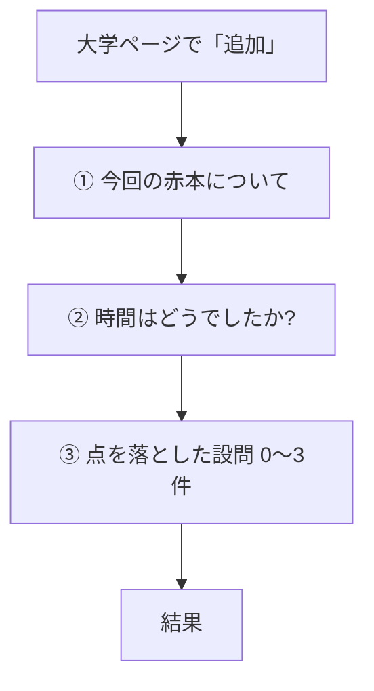

# 赤本記録の質問分岐(現状・編集用)

更新日: 2026-10-29
正本: `v3.html` のいまの動き。直したいところは表の右端「赤ペン」に書く。

---

## 1. 質問の画面(3つ。順番は固定)

大学のページで「追加」→ 直近のトリセツがあれば先に出す →

いまは出ない: 「何回目?」(自動) / 「まだの分野は?」 / 「習っていない」 / 「1日に使える時間」 / 「ひとこと」 / 「最初の一歩」

### ① 今回の赤本について

| 項目 | 必須 | 赤ペン |
|---|---|---|
| 解いた年度 | 必須。西暦4桁 | |
| 入試日程 | 任意 | |
| 全問題数 | 必須。欄の上にラベル。入力は「（　）問中（　）問正解」 | |
| 正答数 | 必須。同上 | |

### ② 時間はどうでしたか?

| 選択肢 | あとに効くこと | 赤ペン |
|---|---|---|
| 余裕で、見直しまでできた | 時間不足 +0 | |
| ギリギリ終わった | 時間不足 +1 | |
| 時間が足りず、手がつかなかった大問があった | 時間不足 +3 | |

### ③ 点を落とした設問

最大3件。「最大3つまで振り返りましょう」。0件でも次へ。形式を選ぶと理由が入れ替わる。失点の大きさ: 大=3、中=2、小=1。設問メモは出さない。削除はゴミ箱アイコン。

---

## 2. 形式 → 理由 → タグ

### 形式A: 用語・知識

| 理由 | つくタグ | 赤ペン |
|---|---|---|
| 覚えていなかった・うろ覚えだった | 知識不足 | |
| 似た用語と混同した | 知識不足 | |
| 用語は言えるが、仕組みがわかっていなかった | 理解不足 | |
| ミニテ集に載っていない用語だった | 知識不足 | 第7弾で追加 |

### 形式B: 考察(実験・グラフ)

| 理由 | つくタグ | 赤ペン |
|---|---|---|
| 実験結果・データは読めたが、そこから結論を正しく導けなかった | 考察 | |
| そもそもグラフや表が何を言っているのかわからなかった | 考察 | |
| 前提となる知識がなくて考えられなかった | 知識不足 | |

### 形式C: 論述

| 理由 | つくタグ | 赤ペン |
|---|---|---|
| 何を書けばいいかわからなかった | 理解不足 | |
| 書いたが、要素(キーワード)が足りなかった | 論述 | |
| 字数制限に収めようとして時間を浪費した | 論述 | |
| 書いた文の日本語がおかしかった(主語と述語・原因と結果がおかしい、てにをはがおかしい、用語の使い方がおかしいなど) | 論述 | 第7弾で追加 |
| 時間がなくて書けなかった | 時間不足 | |

論述の行き先: 要素不足があれば要素不足(知識系/考察系・似た問題に会ったか を聞く)。なければ、字数で浪費と日本語の乱れのうち失点の大きいほう(同じなら字数)。

### 形式D: 計算

| 理由 | つくタグ | 赤ペン |
|---|---|---|
| 解き方がわからなかった | 理解不足 | |
| 初めて見る形で、手がつかなかった | 計算・処理 | 第7弾で追加 |
| 立式はできたが、計算や処理でミスした | 計算・処理 | |
| 問題の指定(有効数字・何を求めるか など)を読み落とした | ケアレス | 第7弾で追加 |

### 形式E: 正誤問題

| 理由 | つくタグ | 赤ペン |
|---|---|---|
| そもそも選択肢を絞ることができなかった | 知識不足 | |
| 2つまで絞れたが外した | 知識不足 | |
| 「誤っているもの」「全て選べ」など、問題文をよく読んでいなかった | ケアレス | |

同点のとき: 理解不足 → 知識不足 → 考察 → 論述 → 計算 → ケアレス → 時間不足。点が全部0なら「目だった課題なし」。

---

## 3. 結果のあと(ここで1本に絞る)

タグが2つ以上なら、生徒が1つ選ぶ。余力の提案は出さない。選んだタグで、次の追加質問とアクションが決まる。

| 選んだタグ | 追加の選択 | 記入 | 赤ペン |
|---|---|---|---|
| 理解不足 | (1)授業ノート / 授業動画・e-step / 先生に質問する (2)どの教材で練習しますか。優先順位なし | 約束のあと「今回よかったところ」任意 | |
| 知識不足 | ミニテ集の目標 8割以上 / 9割以上 / 全問正解 | 約束のあと任意 | |
| 考察 | 授業で扱った? ある→教材、ない→赤本解説 | 次への一手は必須(ひな形を選ぶか、自分で入力)。約束のあと任意 | |
| 論述(要素不足) | 知識系か考察系か → 似た問題に会った? ある→解き直し、ない→答案と模範解答 | 約束のあと任意 | |
| 論述(字数で浪費) | なし。箇条書き→フローチャート→答案 | 約束のあと任意 | |
| 計算・処理 | なし | 次への一手は必須。約束のあと任意 | |
| ケアレス | なし | 次への一手は必須。約束のあと任意 | |
| 時間不足 | なし | 次への一手は必須。約束のあと任意 | |
| 目だった課題なし | なし | 約束の前に「今回よかったところ」必須 | |

単元: 知識不足、理解不足(冊子の教材を選んだとき。口頭説明は除く)で、任意に最大3つ。「単元(任意・3つまで)」のリストから選ぶ。約束の文は「単元名・単元名のミニテ集で9割以上取れるまで繰り返す」のようになる。教材名が入る約束では、「次の赤本を解いているとき」を出さない。

約束: 「やること」を、いつやるかと一緒に保存。分量のラジオ(最初の一歩など)はない。書き換え可。複数日に分けてよい。右の「文を消して自分で書く」で空にできる(元に戻すボタンはない。再約束の画面だけ「元の文にもどす」)。いつやるかは「今日 / 明日 / 3日以内 / 1週間以内 / 次の赤本を解いているとき」。最後を選ぶと日付なしで、解き直しの質問は出さない。それ以外を選んだときは「赤本の解きなおし、一週間以内にもう1回やる?(やる / やらない)」を聞き、「やる」なら今日から7日後が期限の「赤本を解き直す」約束を別に入れる。次の赤本の記録ができたあと、ホームで「達成できましたか?」を聞く。

「やること」に最初から入る文(手順の説明は足さない):

| 選んだ課題 | 入る文 | 赤ペン |
|---|---|---|
| 理解不足 | 「(確認資料)で確認する → (教材)の問題を解く」。口頭説明は「口頭で説明する」、先生に質問は「先生に質問する」 | |
| 知識不足 | 「ミニテ集で(8割以上取れる/9割以上取れる/全問正解できる)まで繰り返す」 | |
| 考察・計算・ケアレス・時間不足 | 生徒が書いた「次への一手」(書くとすぐ反映。書き換えたあとは上書きしない) | |
| 論述 | 要素不足: 知識系/考察系の確認 → 解き直し or 答案と模範解答の比較 / 字数で浪費: 箇条書き→フローチャート→答案 / 日本語の乱れ: 声に出して読み直し、主語述語・原因結果に線 | |
| 目だった課題なし | 課題の見出し | |

選ぶ前・書く前は、その課題の見出しが入る。

結果画面: 正答率(目標以上ならクラッカー🎉と紙吹雪を1回) → 課題が複数なら1本選ぶ → 次の赤本までにやること → (課題なしは今回よかったところ) → (考察・計算・ケアレス・時間不足は次への一手) → 約束 → 「約束カードに保存しました」 → (課題なし以外は今回よかったところ・任意) → AIに相談(▼で開く) → 保存してトップに戻る(右下)。説明の長文は出さない。例は入力欄の中。

## 3b. 約束ページの「未回答の約束があります」

ホームの確認で「未完了」と答えた約束(内部名は保留)があるとき、約束ページの未完了タブに出る。▼で開くと、約束ごとに「小さくして再約束」「手放す」。期限が来てまだ答えていない約束は、いまもホームの「確認待ち」に出る。

---

## 4. わたしのトリセツ

試験中は見ない。蓄積して、次の赤本の前に見返す。

- 下部ナビの表示は「わたしのトリセツ」(左端)。アイコンは点灯した電球。約束のアイコンは指切り(小指のフック)
- 中は約束と同じタブ分け。次への一手(赤) / 今回よかったところ(青)。新しいものが上。各10件。自分で消せる
- 戻るはヘッダー左の◁。ホームでは出さない
- 結果の◁は、点を落とした設問へ戻る(ホームへ飛ばない)
